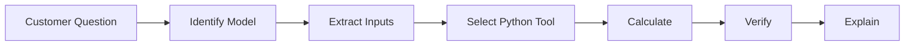

# Supply Chain Analytics: Inventory Decision Agent

An interactive Streamlit web application and decision-support agent for supply chain operations research. The agent accepts natural-language inventory questions and supports 5 core operations research inventory models.

## 🏗️ Architecture Pipeline



1. **Customer Question**: Accepts natural language inventory queries from managers and analysts.
2. **Identify Model**: Classifies the query into one of 5 models:
   - **EOQ**: Economic Order Quantity
   - **Quantity Discount**: Multi-tier price breaks
   - **Safety Stock & ROP**: Continuous review $(R, Q)$
   - **Fixed-Period Review**: Periodic review $(P, S)$
   - **Newsvendor**: Single-period stochastic perishable/seasonal inventory
3. **Extract Inputs**: Parses numerical values, currency symbols, percentages, and discount tiers. Detects missing inputs and alerts the user.
4. **Select Python Tool**: Routes extracted inputs to numerical tools in `inventory_tools.py`.
5. **Calculate**: Executes pure Python calculations using standard operations research formulas.
6. **Verify**: Asserts operational integrity, non-negativity, service level bounds ($0 < CSL < 1$), profitability ($p > c > s$), and cost balance.
7. **Explain**: Generates executive recommendations with KPI cards, interactive Altair charts, step-by-step formula breakdowns, and managerial insights.

---

## 🎓 Verifiable Calculations (Student Audit & Verification)

Every calculation tool in `inventory_tools.py` deterministically returns all 8 required verification components:
1. **Inputs Extracted**: Structured dictionary of extracted numerical parameters.
2. **Variable Definitions**: Operations research variable symbols and descriptions.
3. **Formula**: Canonical mathematical formula in symbolic notation.
4. **Formula with Substituted Values**: Formula populated with exact numerical values.
5. **Intermediate Calculations**: Fully computed intermediate steps (numerators, variance components, critical fractile, costs).
6. **Final Answer**: Recommended integer decision quantity and exact optimal value.
7. **Verification Checks**: Deterministic operational consistency and constraint checks.
8. **Assumptions**: Core operations research assumptions underlying the model.

All numerical calculations originate strictly from the deterministic Python tools, ensuring that intermediate calculations are never hallucinated or independently generated by the language model.

---

## 🚀 How to Launch the Streamlit Web Application

To run the Streamlit web application locally, open a terminal in the project directory and run:

```powershell
streamlit run app.py
```

Or using the workspace Python:
```powershell
python -m streamlit run app.py
```

The web application will open in your default browser at:
`http://localhost:8501`

---

## 🖥️ Streamlit Interface Features

1. **Natural Language Agent Tab**:
   - Multi-line text input for any inventory scenario.
   - One-click sample query loader from the sidebar covering all 5 inventory models.
   - Visual 7-step pipeline execution trace with status indicators.
   - Executive KPI metric cards for rapid managerial decision-making.
   - Interactive Altair visual charts:
     - **EOQ**: Cost trade-off curves (Holding vs. Ordering vs. Total Cost) with optimal $Q^*$ marker.
     - **Quantity Discount**: Total annual cost comparison across tiers with the optimal tier highlighted.
     - **Safety Stock & ROP**: Normal distribution bell curve of lead-time demand with safety stock buffer and ROP trigger cutoff.
     - **Fixed-Period Review**: Inventory position breakdown (on-hand, pipeline, backorders) vs. Order-Up-To Level $S$.
     - **Newsvendor**: Marginal underage ($C_u$) vs overage ($C_o$) cost comparison and expected profit payoffs.
2. **Interactive Parameter Calculator Tab**:
   - Direct manual slider and numerical inputs for all 5 models to test "what-if" parameter sensitivities.
3. **Mathematical Formulations Reference Tab**:
   - Complete operations research cheat-sheet with LaTeX formulas.

---

## 🧪 Running Automated Tests

To run the full automated test suite:

```powershell
pytest tests/test_inventory_tools.py -v
```
